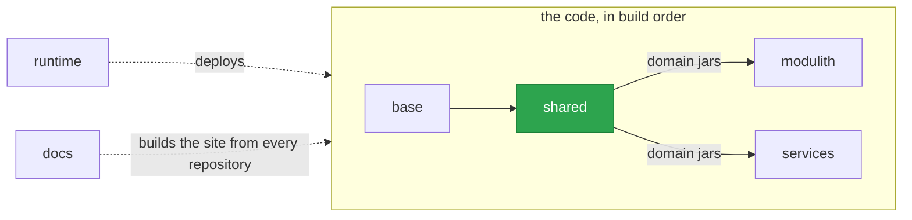

# FF Logistic: shared

**What FF Logistic writes once, whichever implementation runs: the business rules, the identity service and the analytics loader.**

Part of **[FF Logistic](https://github.com/ffetih/ff-logistic-docs)**: one logistics product built twice, as a modular monolith and as microservices, on the same Kubernetes platform, behind one switch. The business rules are written once; only the wiring differs. Start at the hub for the whole picture.

## What's here

| Part | What |
| :--- | :--- |
| `domain/ff-domain-standards` | Pure functions: GS1 check digits and SSCCs, ISO 6346 container codes, the EN 16258 / ISO 14083 emissions calculator |
| `domain/ff-domain-warehousing` | Warehouses, bins, ASNs, receiving into SSCC-labelled pallets; REST under `/api/v1/wms` |
| `domain/ff-domain-transportation` | Shipments over multimodal legs, their lifecycle, CO2e footprint and e-CMR; REST under `/api/v1/tms` |
| `domain/ff-domain-routing` | Territories and route plans with time windows, optimized with Timefold; stop completion and proof of delivery; REST under `/api/v1/geo` |
| `contracts` | What goes out on Kafka, written once: one example message per topic, and the check both implementations' tests run against what they really send (`ff-contracts`) |
| `identity` | The facade over Keycloak: sign-in, service tokens, and the published keys every application verifies tokens against |
| `analytics-loader` | Deliveries from Kafka into the analytics database, tenant-locked with row-level security (S6) |

Each domain core is a plain library: its entities, rules, Flyway migrations and REST API. Where it needs another area it declares a **port** (an interface such as `DistanceLookup`), and each implementation fills the port its own way: a method call in the modulith, an HTTP call or a Kafka event between the services. A core tests its own rules once, in a small Spring Boot application under its `src/test`.

## Build

```bash
./build.sh    # after ../base/build.sh: installs the cores and builds identity
```

## Where it fits

Six repositories: base, then shared, then modulith and services are built in that order; runtime deploys them; docs builds the documentation site from all six. This one is green.



## Read more

- This repository's page on the documentation site: [Shared](https://ffetih.github.io/ff-logistic-docs/shared/index.html)
- The hub, with the architecture, the decisions and the plan: [ff-logistic-docs](https://github.com/ffetih/ff-logistic-docs)
- Every page, in one site: [ffetih.github.io/ff-logistic-docs](https://ffetih.github.io/ff-logistic-docs/)
